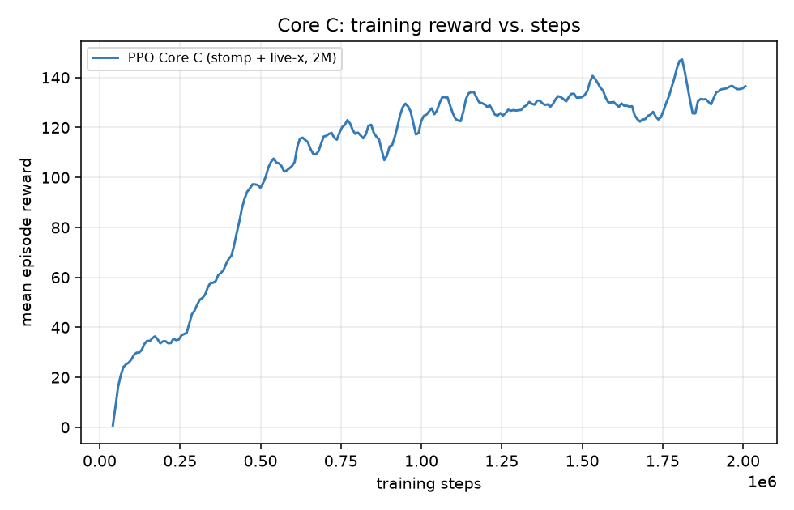
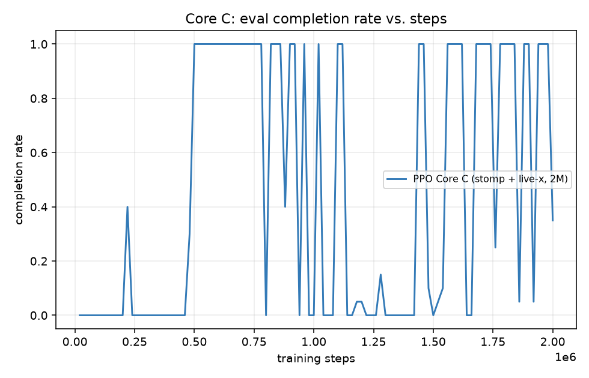
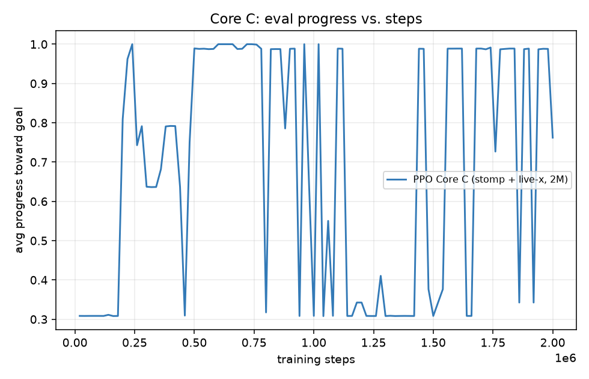

# Mario RL — Write-up

Python 3.12, Gymnasium, Stable-Baselines3 PPO, pygame-ce for rendering only. The simulation (`game/`) is pure Python/NumPy: deterministic given a seed, resettable, and headless. PPO is SB3’s; effort went into the MDP, not re-deriving the optimizer.

Gameplay (Watch agent, level 1): [Loom](https://www.loom.com/share/de38fd773e084ab49decfce4c64cb7c1). Weights: `runs/core_c_fix/best_model.zip`.

## 1. MDP formulation

**Observation.** A 47-D feature vector, not pixels. Features are cheap to train, and a bad number is printable. All values are scaled to roughly \([-1,1]\) or \([0,1]\).

| idx | feature | scale |
|---|---|---|
| 0–1 | player \(v_x, v_y\) | max run speed / terminal velocity |
| 2–3 | on_ground, facing | \(\{0,1\}\), \(\{-1,1\}\) |
| 4–38 | 7×5 tile window, player-centered | tile id / 5 |
| 39–44 | two nearest living enemies: \(\Delta x, \Delta y, v_x\) | 10 tiles / enemy speed; absent \(\to (1,1,0)\) |
| 45–46 | distance to goal, time remaining | level width; \(1 - t/T_{\max}\) |

Enemy \(v_x\) replaced raw distance: timing a jump needs heading, not \(\sqrt{\Delta x^2+\Delta y^2}\).

**Actions.** `Discrete(6)`: noop, left, right, jump, left+jump, right+jump. A classic pad is already discrete; a run modifier is unused (one max speed). Combined jump-and-move actions avoid having to press two buttons in one tick.

**Reward** (per sim tick; `shaped_time` is the Core sum):

- `progress = Δ(max_x)` — new rightward high-water only (no double-pay for backtracking).
- `position = 0.3 · Δx` — signed live \(x\), so retreating after banking max-\(x\) is not free.
- `stomp = +5` if falling onto an enemy from above (side/underside still kills; bounce applied).
- `time = −0.02` / tick; `goal = +100`; `death = −15`.

Idle for a full 2400-tick episode costs \(-48\), worse than several deaths. An earlier mix (\(-0.01\) time, \(-50\) death) made idling cheaper than attempting the first enemy — that was a real local optimum, not a PPO bug (Section 3).

Episode: `terminated` on pit / lethal contact / goal; `truncated` at 2400 ticks so timeouts bootstrap instead of looking like deaths.

## 2. Method

MLP policy, two layers of 128 units (`MlpPolicy`). PPO (`configs/ppo_baseline.yaml`, seed 0): `n_steps=1024`, `batch_size=256`, `n_epochs=10`, \(\gamma=0.99\), \(\lambda_{\mathrm{GAE}}=0.95\), clip \(0.2\), `ent_coef=0.02`, `vf_coef=0.5`, `lr=3\cdot10^{-4}`, 2M steps, 8 `SubprocVecEnv` workers, frame-skip 2. Eval every 20k steps, 20 deterministic episodes; `EvalCallback` writes `best_model.zip`.

Train: `python -m agent.train --config configs/ppo_baseline.yaml --seed 0`.  
Eval: `python -m agent.play --checkpoint runs/core_c_fix/best_model.zip --headless --episodes 100`.  
Hardware: Apple M1 Pro, CPU only, **~9.4 min** for the Core 2M-step run (~3600 fps).

## 3. Results

**Core (level 1), 100-episode deterministic eval.**

| | random | PPO `runs/core_c_fix` |
|---|---|---|
| completion | 0% | **100%** |
| progress | 5.6% | **100%** |
| reward | −42 | **+176** |
| end cause | timeout | **goal** (464 ticks) |

The 100% number is `best_model` (argmax). At the raw 2M cutoff the *stochastic* rollout policy was still exploring (~35% complete). Model selection is part of the result.

**What did not work (and what we changed).**

1. *Idle local optimum.* With death \(=-50\) and time \(=-0.01\), PPO learned to walk a bit, bank max-\(x\), retreat, and time out (completion 0%, ~74% timeouts). Idle cost (\(-24\)) was cheaper than one death. Rebalance to \(-15\) / \(-0.02\): 0% timeouts, 100% first-enemy deaths, ~31% progress. Motivation fixed; skill was not.

2. *More steps were not enough.* Same MDP, 5M vs 2M: identical 0% complete, 30.8% progress, 137 ticks, 100% enemy. A 64-unit net and `ent_coef=0.01` never found the jump. Extra compute was a ceiling, not a budget problem.

3. *Sparse vs shaped (pre-stomp).* Sparse \(\to\) never moves. Shaped without time \(\to\) advance, bank, retreat (episode-end progress 0% despite mid-episode reward). Time penalty is what forces a committed attempt. Those ablations used the *old* (no-stomp) MDP; they diagnose incentives, they are not the Core table above.

4. *Stomp + live-\(x\) + enemy \(v_x\) + 128-wide net* is what actually produced 100% level-1 completion. Side contact remains lethal. That is a Mario rule, not a removed obstacle.

5. *Held-out level 2 (Core weights, never trained on it):* 0% complete, 45% progress, **100% pit**. The agent stomps the first walker (same as level 1) then falls in the first pit (tiles 38–40 — the same gap it clears on level 1). Level 2 is one tile taller; first-enemy timing shifts. The policy is a **memorized level-1 trajectory**, not “see hole, jump.”

6. *Train-on-everything from scratch (`ppo_robust`)* forgot even level 1 (0%, first enemy). *Fine-tune curriculum* onto level 2 from the 100% agent: level 2 progress rose to ~77%, but level 1 fell to **0% pits**. Mixing maps overwrote the Core skill. Those checkpoints are not submitted.

## 4. Limitations and next steps

The Core agent completes one authored layout. It does not have a transferable jump-over-gap skill. Observation is local, so transfer is *possible*; PPO overfit the training timing.

With two more weeks: (a) freeze the level-1 policy with a KL or replay constraint while mixing new maps; (b) procedurally vary *only* pit width/position while keeping the rest of level 1, so the jump has to become visual; (c) pixels+CNN as an observation ablation, not as a substitute for (a)–(b). A research budget would treat catastrophic forgetting on sequential maps as the actual question, not “train longer.”

Pixels+CNN and a from-scratch PPO implementation were skipped on purpose: the brief caps stretch at 10%, and a broken Core cannot be bought back with extras.

## 5. Disclosure

- **Libraries:** Gymnasium 1.3, Stable-Baselines3 2.9 (`PPO`, `EvalCallback`, `SubprocVecEnv`), PyTorch, pygame-ce (render path only). No `gym-super-mario-bros`, no NES ROM, no emulator. Pinned in `requirements.txt`.
- **No copied tutorials** for the engine or reward; physics constants were tuned in human-play, not taken from a reference Mario sim. Sprites are procedural.
- **AI:** the engine, env, trainer, renderer, and tests were implemented with AI coding assistants (Claude Code against an internal design brief; later Cursor for the stomp/live-\(x\) fix, curriculum attempt, and this writeup). Hyperparameters and the idle-optimum diagnosis came from training logs, not from a copied notebook. Failed stretch runs are reported rather than deleted.
