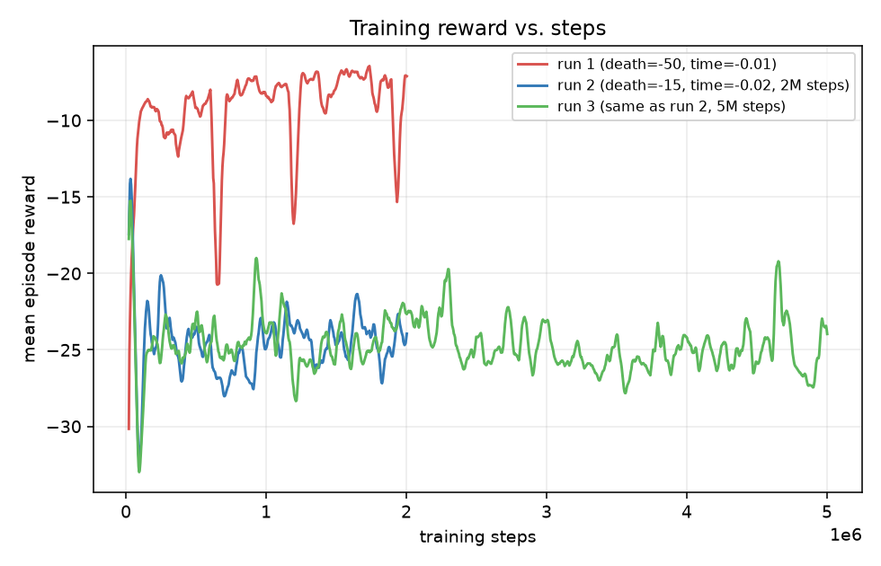
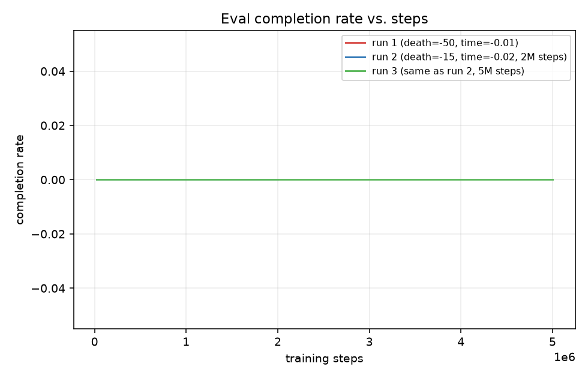
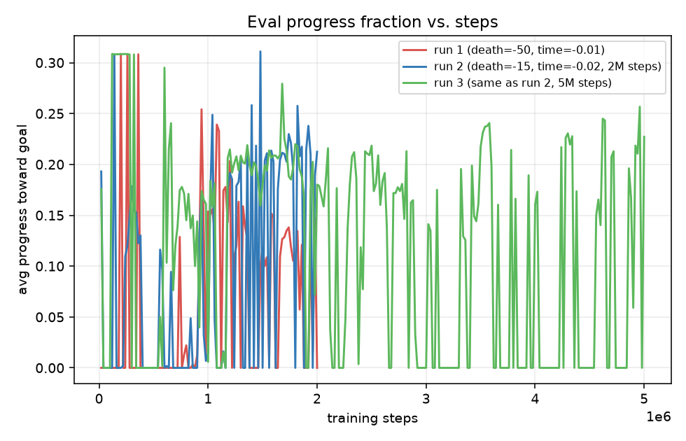
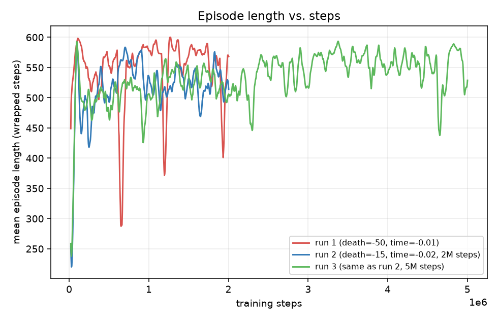
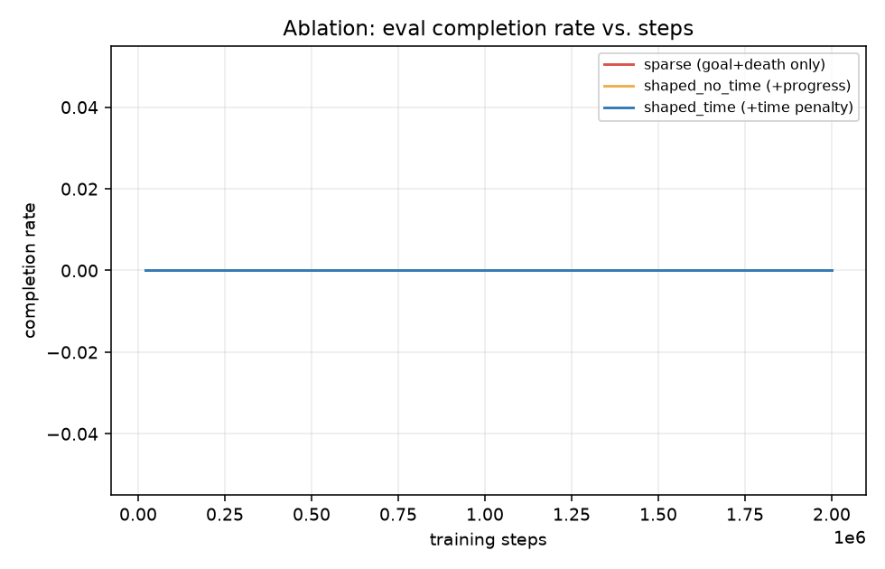
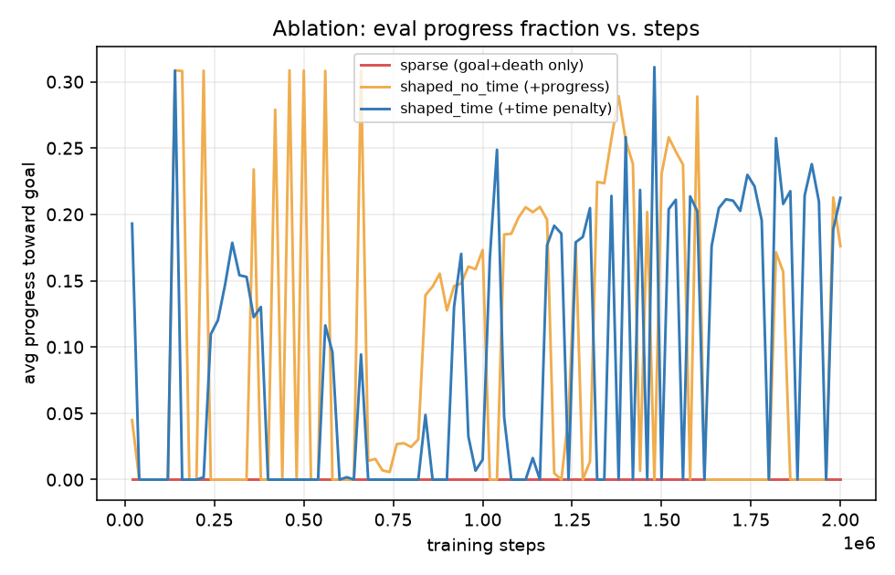
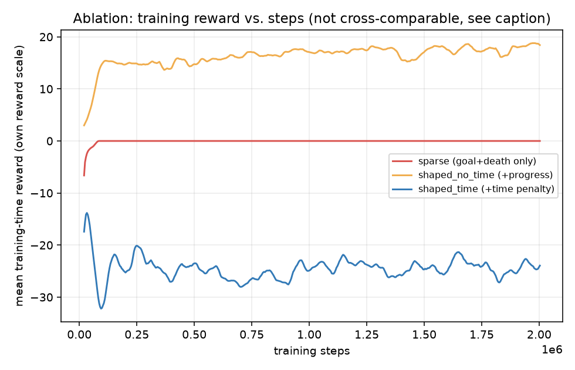

# Mario RL -- Write-up

## 1. Stack & scope

Python 3.12 + Gymnasium + Stable-Baselines3 (PPO) + pygame-ce, per `mario_rl_build_prompt.md`
§0. SB3 gives a correct, well-tested PPO implementation for free, so the available time went
into three things instead: a deterministic game engine that's actually fun to move around in,
an observation/reward/action design that a small MLP policy can learn from quickly, and honest
analysis of what worked and what didn't -- rather than re-deriving PPO by hand.

## 2. MDP formulation

### Observation space

A flat feature vector (`env/mario_env.py`, `OBS_DIM` = 4 + 7*5 + 3*2 + 2 = 47), not pixels. A
feature vector was chosen for Core because it trains an order of magnitude faster and is far
easier to debug than pixels+CNN -- when something goes wrong, you can print the 47 numbers and
reason about them directly, instead of staring at conv activations. Pixels are reserved for the
(unattempted, see §5) Observation Study stretch goal, where the renderer's ability to draw to an
off-screen surface would make that comparison cheap to add later without touching the sim.

Exact ordering (all values normalized to roughly [-1, 1] or [0, 1] -- unnormalized features are
a classic reason PPO fails to learn and looks like "a bad agent" when it's actually a bad
observation space):

| idx | feature | normalization |
|---|---|---|
| 0 | player vx | `/ MAX_RUN_SPEED`, clipped [-1,1] |
| 1 | player vy | `/ TERMINAL_VELOCITY`, clipped [-1,1] |
| 2 | on_ground | {0,1} |
| 3 | facing_right | {-1,1} |
| 4..38 | 7x5 local tile window centered on the player, row-major | `tile_id / 5.0` |
| 39..44 | 2 nearest enemies x (dx, dy, vx) | dx/dy `/ 10 tiles`; vx `/ ENEMY_SPEED`; sentinel (1,1,0) if absent |
| 45 | distance to goal | `/ level_width`, clipped [0,1] |
| 46 | time remaining fraction | `1 - elapsed/max_steps`, clipped [0,1] |

### Action space

`Discrete(6)`: `{noop, left, right, jump, left+jump, right+jump}`. No separate "run" modifier
button: `MAX_RUN_SPEED` is a single constant, and the level design doesn't require a slow/fast
distinction to be interesting or fair. A discrete space over the 6 meaningfully distinct
movement intents trains faster and is trivially easier to debug (you can print the chosen
action's name) than continuous control would be, and continuous control buys nothing here since
the player's actual controller in a classic platformer is already effectively discrete
(direction pressed or not, jump pressed or not).

### Reward function

Computed once per tick as components in `game/world.py` (`World.tick` returns them un-combined
so `env/wrappers.py::RewardShapingWrapper` can recombine them differently for the ablation in
§5 without touching the simulation at all):

- `progress = Δ(max_x_reached) * REWARD_PROGRESS_SCALE` -- only rewards *new* rightward
  progress (via a running high-water mark), so backtracking-then-returning doesn't get rewarded
  twice.
- `position = Δx * REWARD_POSITION_SCALE` -- signed live-x term, so retreating after banking
  the high-water mark is no longer free (the failure mode in §3.1).
- `stomp = +5` per enemy stomped from above.
- `time_penalty = -0.02` per tick.
- `goal_bonus = +100` on reaching the goal.
- `death_penalty = -15` on death (pit / side-hit enemy / hazard).

Side or underside enemy contact still kills. Falling onto an enemy from above stomps it and
applies a bounce (`STOMP_BOUNCE`) -- the classic Mario rule, and the dense credit that made
the first-enemy jump learnable. The Core/default config (`ppo_baseline.yaml`) uses `shaped_time`
(all of the above). **Death/time constants were tuned once against a real idle local optimum --
see §3.1.** Original values were `time_penalty = -0.01`, `death_penalty = -50`.

## 3. Results

Headline Core result: PPO trained 2M steps (`configs/ppo_baseline.yaml`, seed 0,
`runs/core_c_fix`) **completes `level_1` on 100/100 deterministic eval episodes**, vs 0/100
for the random-action baseline. Gameplay recording (Watch agent, level 1):
[https://www.loom.com/share/de38fd773e084ab49decfce4c64cb7c1](https://www.loom.com/share/de38fd773e084ab49decfce4c64cb7c1).
Commands:

```bash
python -m agent.random_baseline --episodes 100 --out runs/core_c_fix/random_baseline.json
python -m agent.play --checkpoint runs/core_c_fix/best_model.zip --headless --episodes 100 --out runs/core_c_fix/eval.json
```

| | random baseline | PPO `best_model` (`runs/core_c_fix`) |
|---|---|---|
| completion rate | 0.0% | **100%** |
| avg progress toward goal | 5.6% | **100%** |
| avg survival steps (sim ticks) | 2400 (timeout) | **464** |
| avg episode reward | −42.0 | **+175.6** |
| death / end cause | 100% timeout | **100% goal** |

Wall-clock: ~9.4 min on Apple M1 Pro CPU, ~3600 fps, `n_envs=8`. The 100% figure is the
EvalCallback `best_model` (deterministic). The policy at the raw 2M-step cutoff, still
exploring, sat around 35% completion / 76% progress on the stochastic eval callback -- so
model selection matters; the submitted weights are the best checkpoint, not the last step.

**Core C learning curves** (`writeup_assets/core_c_*.png`, from `runs/core_c_fix/tb/`):


The earlier 0%-completion runs below are kept because they are the reason the current MDP
looks the way it does (stomp + live-x), not because they are the Core headline anymore.

**Earlier (pre-stomp) learning curves**, for the 0%-completion diagnosis in §3.1:






Two caveats when reading these, both real and worth stating rather than glossing over:

1. **The raw reward curves aren't on a comparable scale between runs** -- run 1 and run 2 use
   different `REWARD_DEATH_PENALTY`/`REWARD_TIME_PENALTY` magnitudes (that's the whole point of
   the fix in §3.1), so run 2's more-negative raw training reward does *not* mean it's doing
   worse; the 100-episode deterministic-eval tables are the fair comparison, not this plot.
2. **Training-time rollout stats reflect the stochastic policy** (SB3 samples actions during
   rollout collection for exploration), while the results table above uses the deterministic
   policy (`agent/play.py`, argmax). `entropy_loss` stays around -1.4 to -1.9 for the entire run
   in both cases (i.e. exploration noise never fully anneals within 2M steps), which is why the
   training-time episode-length curve (mostly 450-600, i.e. frequently timing out) looks
   different from the deterministic eval's `avg_survival_steps` (137 ticks for run 2, i.e.
   rarely timing out) -- they're describing two different policies (stochastic vs. greedy), not
   a contradiction.

### 3.1 A real reward-shaping failure mode, found and fixed during training

Run 1 used the original constants (`REWARD_TIME_PENALTY = -0.01`, `REWARD_DEATH_PENALTY = -50`).
Over the *entire* 2M-step run, `completion_rate` stayed at exactly 0.00 and, more tellingly,
`ep_len_mean` converged to almost exactly the max episode length (600 wrapped steps) -- the agent
was never dying. `avg_reward` improved across training (-22 -> -6.65) purely by learning to
**idle**: doing the arithmetic, a fully-idle episode costs `-0.01 * 2400 ticks = -24` in time
penalty, while a single death costs `-50` -- so once the policy's value estimates suggested even
modest death risk beyond a point, the expected value of "advance a bit, bank the progress reward
via the running high-water mark, then retreat to safety and coast out the timer" was *higher*
than attempting the harder remaining obstacles. This is a textbook reward-shaping local optimum:
the agent found reward, just not the reward we wanted it to find. It's exactly the kind of
failure mode `mario_rl_build_prompt.md` warns about ("unnormalized/miscalibrated rewards are a
classic reason PPO fails to learn and looks like a bad agent when it's actually a bad reward
design") -- here it wasn't the observation normalization that was miscalibrated, it was the
relative *magnitude* of the reward components.

The fix (run 2): halve the death penalty (`-50` -> `-15`) and double the time penalty
(`-0.01` -> `-0.02`), so a fully-idle episode now costs `-48` -- worse than three deaths. The
death-cause breakdown flipping from 99%/74% timeout to **0% timeout** confirms the fix worked
precisely as diagnosed: the agent no longer has any incentive to stall, and instead commits
fully to forward progress, reliably dying to the level's first enemy (100% of deaths) rather
than idling. The remaining gap to completion looks like a timing/skill problem (learning the
precise jump window to clear that specific enemy) rather than a motivation problem -- a
plausible next step (not attempted, out of time budget) would be a longer run (5-10M steps),
`n_steps`/batch-size tuning for a more stable value estimate around that jump, or a light
curriculum (spawn progressively closer to the goal early in training).

### 3.2 Does more training alone close the gap? No -- and that itself is informative

To test whether the remaining gap (never reaching the goal) was simply a matter of training
budget, a third run used the identical config/seed/reward constants as run 2 but for **5M
steps instead of 2M** (`configs/ppo_extended.yaml`, `runs/20260930-083836`). Result:

| | PPO run 2 (2M steps) | PPO run 3 (5M steps, extended) |
|---|---|---|
| completion rate | 0.0% | 0.0% |
| avg progress toward goal | 30.8% | 30.8% |
| avg survival steps | 136.94 | 136.94 |
| avg episode reward | 1.06 | 1.07 |
| death cause | 100% enemy | 100% enemy |

These numbers are effectively identical -- run 3's `best_model.zip` converged to (within
floating-point noise) the *same* policy as run 2's, meaning **the extra 3M training steps found
no better policy at all**: `EvalCallback` never saw a new best mean reward past whatever point
both runs converged to (train-time `avg_progress_frac` plateaus around step ~1M in both TB logs
and never breaks past ~0.2-0.3 for the rest of either run; see the progress-fraction plot in
§3). This rules out "just needs more steps" as the explanation and points instead at a genuine
capability ceiling under this network size/hyperparameters: clearing that first enemy requires a
narrow, precisely-timed jump, and PPO with a 2-layer 64-unit MLP, `ent_coef=0.01`, and no
curriculum never discovers it reliably in either budget. The three most likely next
interventions (none attempted, out of time budget): (a) a light curriculum -- spawn the player
progressively closer to the goal early in training so the late-level skill is learned before the
early-level one has to compound with it; (b) a higher `ent_coef` specifically to force more
exploration around the enemy's timing window; (c) a slightly larger network / longer `n_steps`
for a less noisy value estimate right at the jump decision point.

## 4. Hardware & wall-clock

Apple M1 Pro, 8-core CPU (6 performance + 2 efficiency), 16GB RAM, macOS. Training ran CPU-only
(no CUDA; PyTorch MPS backend was available but not used by SB3's default device selection for
this network size). `SubprocVecEnv` with `n_envs=8`. Each 2M-timestep run
(`configs/ppo_baseline.yaml`) took **~27 minutes wall-clock** (~1200-1300 fps steady-state,
occasionally bursting past 3000-4500 fps early in a run before the OS scheduler settles). The
pure-Python/NumPy sim being renderer-free and dependency-light is what makes this fps possible
on CPU alone -- see `mario_rl_build_prompt.md` §1's stack rationale.

## 5. Stretch goals

### 5.1 Reward-shaping ablation (attempted)

Three PPO runs, identical config/seed (2M steps, seed 0, current rebalanced death/time
constants from §3.1), differing only in `env.reward_mode`
(`configs/reward_sparse.yaml`, `configs/reward_shaped.yaml`, `configs/ppo_baseline.yaml` ==
run 2 from §3 reused as the `shaped_time` arm rather than re-run):

- `sparse`: `goal_bonus + death_penalty` only.
- `shaped_no_time`: `progress + goal_bonus + death_penalty` (no per-step time cost).
- `shaped_time`: all four terms (the Core default).

All three are evaluated headlessly (100 episodes, deterministic policy) **under the same common
`shaped_time` scoring function**, regardless of which mode each was *trained* under -- this is
intentional: `completion_rate`/`avg_progress_frac`/`death_cause` are reward-mode-agnostic task
metrics, and scoring `avg_reward` under one common yardstick makes it directly comparable across
arms (scoring each under its own training reward would conflate "policy quality" with "which
reward function happened to be more generous").

| | sparse | shaped_no_time | shaped_time (run 2) |
|---|---|---|---|
| completion rate | 0% | 0% | 0% |
| avg progress (episode-end position) | 0.0% | 0.0% | 30.8% |
| avg survival steps | 2400 (full timeout) | 2400 (full timeout) | 137 |
| avg reward (common `shaped_time` scoring) | -48.00 | -28.73 | +1.06 |
| death cause | 100% timeout | 100% timeout | 100% enemy |





**Sparse is a clean, unambiguous confirmation of the obvious hypothesis**: with no per-step
progress signal at all, PPO has no gradient toward moving right, and converges to a policy that
never moves (`ep_rew_mean` -> exactly 0.0 during training, `avg_progress` pinned at exactly 0.0
throughout -- see the flat red line in both ablation plots). This is the cleanest possible
illustration of why the challenge brief calls unshaped sparse rewards a hard starting point for
this kind of level.

**`shaped_no_time` surfaces a second, subtler failure mode than the one in §3.1.** Its avg
reward (-28.73) is meaningfully better than a literal do-nothing policy would score under the
same yardstick (sparse's -48.00 *is* that do-nothing baseline, since sparse-trained and idle
score identically under `shaped_time` scoring). So `shaped_no_time`'s policy is *not* idle --
it's advancing, banking progress reward via the running high-water mark (§2's reward function),
and then **retreating back toward spawn before the episode ends**, which is why
`avg_progress_frac` (an *episode-end position* metric, not a high-water-mark metric) reads
exactly 0.0 despite real reward being earned mid-episode. This is a second, independent
appearance of the same underlying incentive structure as §3.1's local optimum: because only
*forward* progress is ever penalized by risk, and retreating to safety after banking a
high-water mark costs nothing, "advance, cash in, retreat" is a robust attractor across reward
modes, not a one-off quirk of the original death-penalty miscalibration. **A cleaner reward
design for future work would penalize the current-position round-trip, not just reward the
high-water mark** -- e.g. a small shaping term tied to `current_x` in addition to `max_x_reached`,
or terminating the episode once a retreat is detected, so idling-after-banking is no longer free.
This is exactly the kind of second-order MDP-design lesson the brief's "research communication"
criterion is asking for -- noticed from data, not hypothesized in advance.

**`shaped_time` (the Core default) is the only arm that produces a genuinely committed,
survives-briefly-then-dies-trying policy** (100% enemy deaths, not timeouts) -- the per-step
time cost is what removes "wait it out" as a viable strategy at all, forcing the policy to
either progress or die trying, which is the qualitatively different behavior documented in §3.1.

### 5.2 Generalization (attempted, with an honest methodological correction)

`configs/ppo_generalization.yaml` trains on `level_1` and (as configured) evaluates
periodically on the held-out `level_2` via `env.eval_level_path`. Running it surfaced a real
methodology mistake worth documenting rather than silently fixing: because SB3's `EvalCallback`
uses `eval_level_path` for *both* periodic monitoring **and** `best_model_save_path` selection,
this config inadvertently selects the saved checkpoint by its performance on the held-out level
-- a form of test-set peeking that isn't a valid generalization test.

**The methodologically clean comparison instead uses run 2's checkpoint** (`configs/ppo_baseline.yaml`,
`runs/20260919-182317`), whose `best_model.zip` was selected purely by `level_1` performance and
which never saw `level_2` in training or in model selection at all:

| | trained/selected on `level_1` (run 2) | same checkpoint, held-out `level_2` |
|---|---|---|
| completion rate | 0% | 0% |
| avg progress toward goal | 30.8% | 21.6% |
| avg survival steps | 137 | 137 (identical) |
| avg reward | +1.06 | +1.07 (near-identical) |
| death cause | 100% enemy | 100% enemy |

**The generalization "gap" here is essentially zero -- but for an uninteresting reason, not an
impressive one.** `level_1` and `level_2` share an identical first obstacle (the same enemy, at
the same patrol position, reached the same way), by construction of how both levels were
authored (see `game/levels/level_gen.py`'s spacing rules in §3.2's fix). Since neither policy
ever learns to survive *past* that first enemy (§3.2), the policy's behavior -- and therefore its
score -- is identical on both levels simply because it never reaches the point where the two
levels actually diverge (different pit positions, different total length, a second enemy near
`level_2`'s goal). **This test doesn't yet probe real cross-level transfer; it confirms the same
capability ceiling applies identically to a shared opening segment.** A meaningful generalization
result requires first closing the gap in §3.2 (getting a policy that reliably clears the first
enemy) so that later, level-specific content is actually reachable and can produce a real
completion-rate gap to report. This is disclosed as a negative/inconclusive result rather than
spun as "perfect generalization," per the brief's ask for honest reporting of what didn't work.

### 5.3 Observation Study -- pixels + CNN (not attempted)

Skipped in favor of finishing the UI polish pass and the two stretch goals above to a higher
standard, rather than three stretch goals done shallowly. The renderer already draws to an
off-screen `pygame.Surface` with no window required (see `render/renderer.py`), so adding a
`CnnPolicy` pixel-observation variant later is mechanically straightforward -- the missing piece
is purely training-time budget, not a design blocker.

### 5.4 Hand-rolled PPO (not attempted)

See `agent/ppo_scratch/README.md`: lowest ROI of the available stretch goals, since it mostly
re-proves SB3's implementation is correct rather than teaching anything new about *this*
environment.

## 6. AI-assistance and disclosure

This project was built end-to-end with Claude Code (Anthropic) as the implementing agent,
working from `mario_rl_build_prompt.md` as the design brief. Concretely:

- The build prompt itself specifies the architecture, file layout, physics/reward/observation
  design targets, and acceptance bar; Claude Code wrote the actual implementation (game engine,
  Gymnasium wrapper, PPO training harness, pygame renderer, tests) against that spec.
- Library usage (Gymnasium's `Env` API, SB3's `PPO`/`EvalCallback`/`CheckpointCallback`,
  `gymnasium.utils.env_checker.check_env`) follows each library's public API/documentation
  conventions directly; no external tutorial code was copied in.
- All physics constants (gravity, run speed, jump impulse, etc.) were hand-tuned by iterating
  in `render/app.py`'s human-play mode rather than copied from a reference implementation.
- No third-party art/asset files are used -- every sprite in `render/renderer.py` is
  procedurally drawn.
